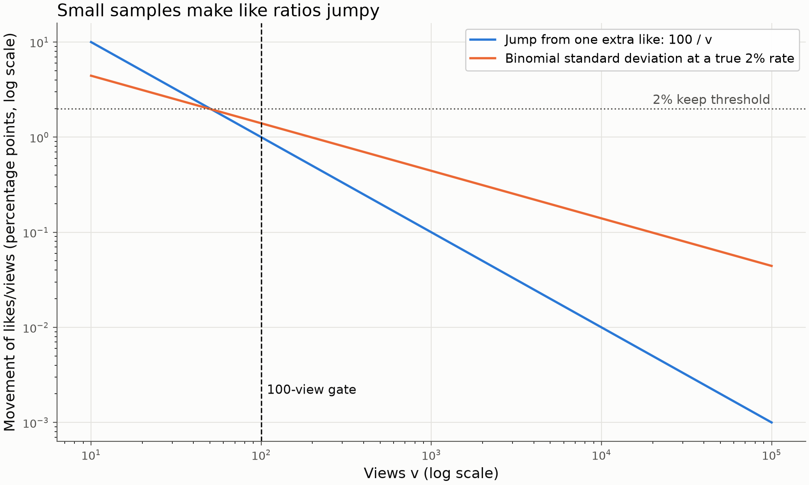
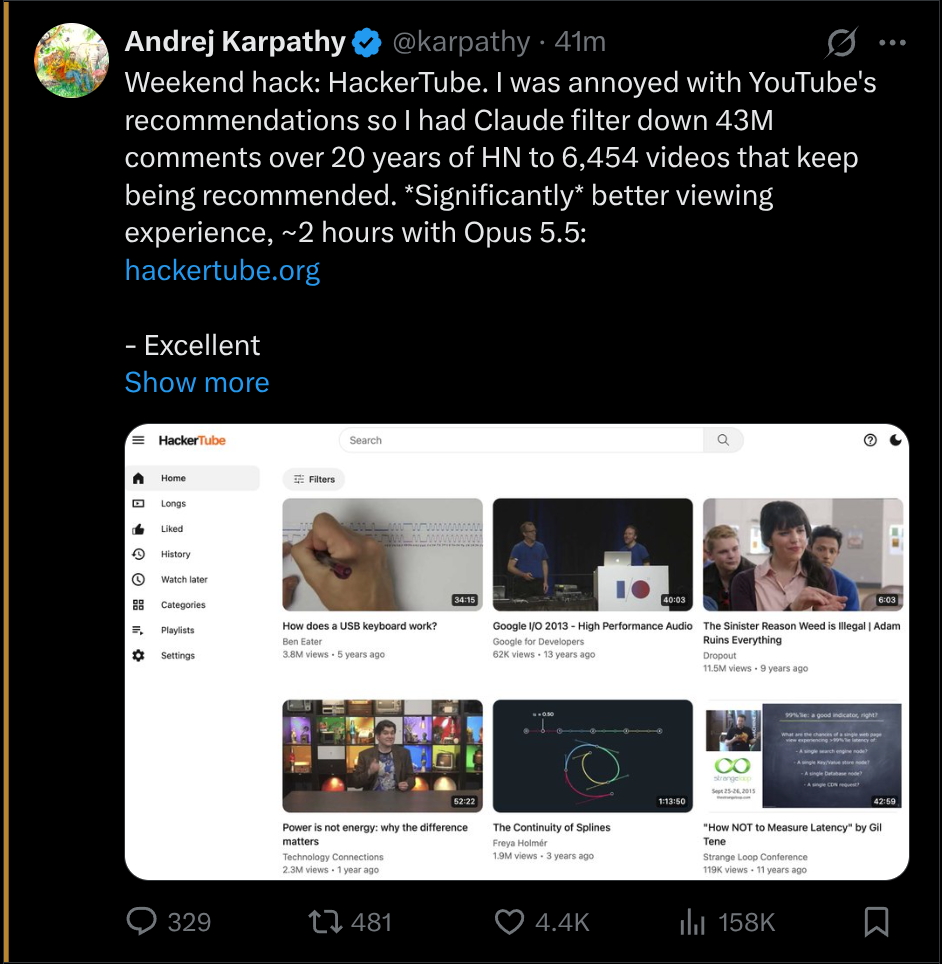
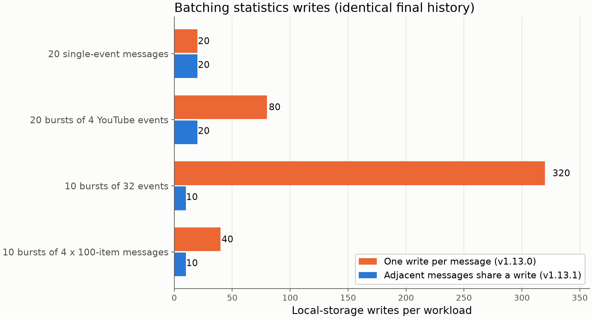

# Minimum Views Filter : masquer les publications peu vues sur X et YouTube

X et YouTube testent d'abord les nouvelles publications auprès d'un petit public. Si vous faites partie de ce public, votre fil se remplit de publications vues quelques dizaines de fois. Le réflexe est de cliquer sur « Pas intéressé » pour chacune, mais chaque clic donne un signal de plus à l'algorithme de recommandation. Vous finissez par étiqueter gratuitement des données pour le système que vous essayez justement d'éviter.

[Minimum Views Filter](https://github.com/GerardWu100/minimum-views-filter) est une extension de navigateur qui prend l'autre chemin. Elle masque les publications et les vidéos sous un nombre de vues que vous choisissez (1 000 par défaut) et ne clique jamais sur rien. Sur X, elle regarde aussi les mentions J'aime, les signets et les réponses par vue. Elle fonctionne dans Chrome, Brave (Chromium 109 ou plus récent) et Firefox (142 ou plus récent, sous forme de module signé par Mozilla). Le code est libre, sous licence MIT.

Le graphique en haut de l'article représente les règles X par défaut selon les vues et les mentions J'aime par vue. La suite explique sa forme.

## Ce qu'elle filtre, et où

Le périmètre est volontairement étroit : l'accueil de X (Pour vous et Abonnements), l'accueil de YouTube et les recommandations à côté de la vidéo en cours. La recherche, les profils, les chaînes et toutes les autres pages restent intacts.

Pour une publication X, les règles s'appliquent dans un ordre fixe :

1. Un créateur de votre liste blanche est toujours affiché. On l'ajoute d'un clic droit sur une publication, avec « Always show this creator ».
2. Si la publication a au moins 100 vues et que les mentions J'aime, les signets et les réponses par vue atteignent tous leur seuil de conservation (2 %, 0,5 % et 0,1 %), elle reste affichée même sous le minimum de vues.
3. Sinon, elle est masquée si les mentions J'aime par vue sont sous 0,5 %, ou si les vues sont sous le minimum.

Un compteur absent ou ambigu est inconnu, pas nul, et les publications inconnues restent visibles par défaut. YouTube n'utilise que les règles de vues. Chaque règle a son propre interrupteur.

Le masquage n'est jamais définitif, car il n'y a pas de liste noire d'identifiants. Une publication masquée à 800 vues qui en affiche plus tard 1 500 revient, si la règle des mentions J'aime le permet aussi. L'historique local des statistiques n'est jamais lu pour prendre une décision.

## Pourquoi les ratios exigent un échantillon minimal

La règle de conservation exige que tous les ratios activés passent en même temps (une version antérieure en acceptait un seul). Avec les réglages par défaut, 10 mentions J'aime, 3 signets et 1 réponse sur 500 vues suffisent, mais 500 signets avec 9 mentions J'aime, non. La vraie question de conception est ailleurs : à partir de quand peut-on se fier à un ratio ?

Soit $v$ le nombre de vues d'une publication et $c$ son nombre de mentions J'aime, de sorte que le taux est $r = c/v$. Une mention de plus déplace $r$ de $1/v$, soit 10 points de pourcentage à 10 vues et 1 point à 100 vues. Deux mentions sur dix vues donnent 20 %, dix fois le seuil de conservation, et ne veulent presque rien dire.

Pour mesurer ce bruit, modélisons chaque vue comme un essai indépendant qui se termine par une mention J'aime avec probabilité $p$. C'est ma simplification, pas un calcul de l'extension. Alors $c$ suit une loi binomiale et

$$
\operatorname{Var}(c) = v\,p\,(1-p), \qquad
\operatorname{Var}(r) = \operatorname{Var}\!\left(\frac{c}{v}\right) = \frac{\operatorname{Var}(c)}{v^2} = \frac{p\,(1-p)}{v},
$$

donc l'écart-type du taux mesuré vaut

$$
\sigma_r = \sqrt{\frac{p\,(1-p)}{v}}.
$$

Pour un vrai taux $p = 2\%$, $\sigma_r$ vaut environ 4,4 points de pourcentage à 10 vues, 1,4 à 100, 0,44 à 1 000 et 0,14 à 10 000. Le bruit ne baisse qu'avec $\sqrt{v}$ : cent fois plus de vues donnent dix fois moins de bruit.

La ligne bleue est le saut causé par une mention de plus, $100/v$ points de pourcentage. La ligne orange est l'écart-type binomial pour un vrai taux de 2 %. Sous environ 50 vues, les deux dépassent le seuil de 2 % lui-même : un ratio élevé y relève davantage de la chance que de la publication. À 100 vues, le bruit reste d'environ 1,4 point, donc un seul ratio reste une preuve faible.

L'extension impose donc un échantillon minimal. Sous 100 vues (réglable), un ratio élevé ne peut ni conserver ni mettre en évidence une publication. Ce plancher est un seuil simple, pas un test de significativité, et le README dit clairement que les ratios fluctuent encore au-dessus.

L'asymétrie est la partie qui me plaît. L'échantillon minimal ne s'applique qu'aux règles qui affichent des publications. La règle qui masque les faibles taux de mentions J'aime fonctionne à tous les niveaux de vues. Sous 100 vues, un ratio bruité ne peut donc que masquer davantage, jamais afficher davantage, ce qui correspond au but : ne pas voir des publications à tout petit échantillon grâce à un ratio chanceux.

Deux détails se trouvent dans la comparaison elle-même. Le code ne divise jamais. Il vérifie $100\,c \ge p\,v$, avec $p$ en pourcentage, plus une petite tolérance de précision machine, pour qu'un cas limite comme 7 mentions sur 10 000 vues (exactement 0,07 %) atteigne bien un seuil de 0,07 % malgré l'erreur d'arrondi en virgule flottante. Une publication à zéro vue n'a pas de ratio et retombe sur la règle de vues. Les règles de conservation acceptent un ratio égal au seuil, alors que la mise en évidence décrite plus bas exige un ratio strictement supérieur.

## Lire les compteurs sans interroger la plateforme

L'extension n'envoie aucune requête à la plateforme ni aucune donnée d'analyse. Chaque nombre qu'elle utilise est déjà dans la page.

C'est plus difficile qu'il n'y paraît. X affiche « 158K » sur le bouton, mais l'étiquette d'accessibilité (le texte lu par un lecteur d'écran) contient souvent le compte exact. L'analyseur préfère les étiquettes exactes au texte arrondi, et si deux candidats exacts divergent, le compte est inconnu. Il ignore les compteurs des publications citées et lit encore les étiquettes quand une autre extension cache le compteur visible avec du CSS. Il comprend les formats anglais et français (« 1,2 M de vues » compris) ; les autres langues restent visibles.

Un bogue trouvé lors de l'audit montre pourquoi ce soin compte. L'étiquette d'un lien de titre YouTube contient aussi le nom de la chaîne, et une chaîne nommée « 10 views » a déjà été lue comme le nombre de vues. L'analyseur retire maintenant les noms des créateurs de la carte avant de chercher un compte.

Cette publication montre la mise en évidence optionnelle, un liseré ambré de 3 pixels sans teinte de fond. Par défaut, elle exige plus de 1 % de signets par vue, plus de 2 % de mentions J'aime par vue et plus de 0,1 % de réponses par vue. Ici, les mentions J'aime sont 4,4K pour 158K vues (environ 2,8 %) et les réponses 329 (environ 0,21 %). Le bouton de signet n'affiche aucun nombre, mais l'étiquette d'accessibilité peut contenir le compte exact, qui doit dépasser environ 1 580.

## Performance

Un fil est une suite de petits changements. L'extension envoie donc chaque changement à la carte concernée au lieu de réanalyser toute la page. Dans un fil synthétique de 200 cartes, 20 changements de compteur sur une seule carte ont demandé 20 lectures au lieu de 4 000, et les changements sans rapport n'en ont demandé aucune au lieu de 4 000. Les onglets cachés suspendent l'observation. Ces chiffres comptent des opérations dans une page simulée (jsdom) ; ce ne sont pas des mesures de processeur ou de mémoire du navigateur.

Les statistiques sont séparées du filtrage. Des messages d'historique adjacents partagent maintenant une seule lecture et une seule écriture du stockage local, jusqu'à 32 messages par transaction, sans minuterie qui retarderait le masquage.

Chaque paire de barres correspond à une charge de travail du banc d'essai, avec le même historique final dans les deux versions. Les messages isolés ne gagnent rien. Les rafales gagnent le plus : 10 rafales de 32 événements sont passées de 320 écritures à 10, et le temps médian synthétique d'environ 1 985 ms à 71 ms. Comme pour le fil, ces chiffres viennent d'un stockage simulé, pas d'un vrai navigateur.

## Ce qu'elle ne peut pas faire

Un filtre local change ce que vous voyez, pas ce que la plateforme enregistre. Lors d'une observation passive d'environ quatre minutes sur mon accueil X, 39 publications ont été masquées à un moment donné. L'une d'elles figurait quand même dans la liste `seenTweetIds` que X a envoyée avec une requête de fil ultérieure. Cette publication a été masquée 45 ms après sa première observation dans la page. La version testée attendait 80 ms avant de traiter les changements. L'extension évalue maintenant les cartes concernées dans chaque rappel de changement. Cela coûte du travail en plus quand X remplit une carte en plusieurs étapes (une charge échelonnée est passée de 20 à 80 lectures de compteur) et réduit la fenêtre sans la fermer. Le démarrage, la navigation et les compteurs chargés en retard peuvent encore laisser des trous, et l'extension n'intercepte ni ne modifie jamais les requêtes.

Les compteurs peuvent aussi être arrondis ou périmés jusqu'au rechargement, et un changement de mise en page peut réduire la couverture (les cartes restent alors visibles comme inconnues). Ne pas cliquer sur « Pas intéressé » ne veut pas dire n'envoyer aucun signal : la plateforme voit toujours tout le reste de votre activité.

Les étapes d'installation, tous les réglages et les notes complètes des bancs d'essai se trouvent dans le [dépôt GitHub](https://github.com/GerardWu100/minimum-views-filter).
