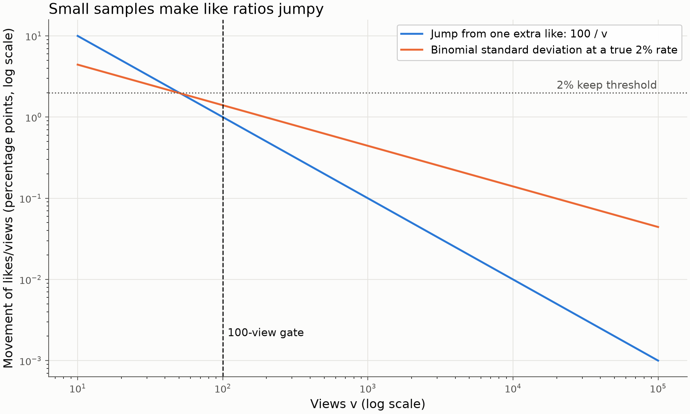
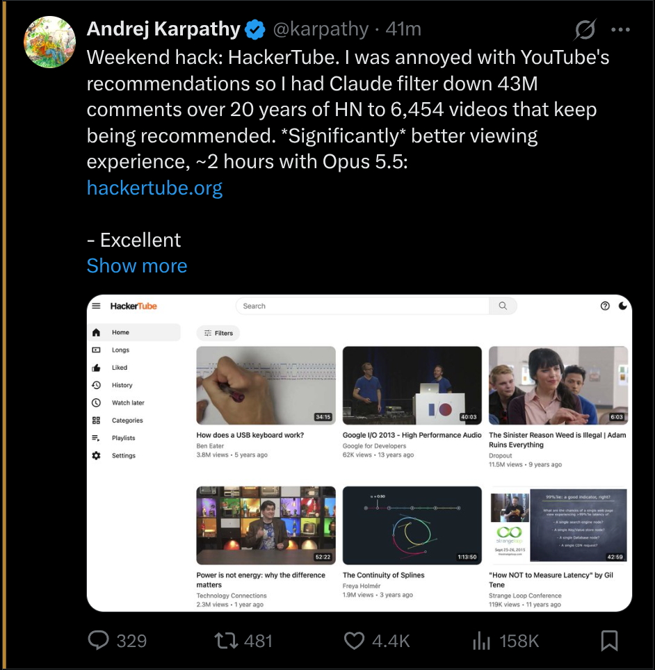
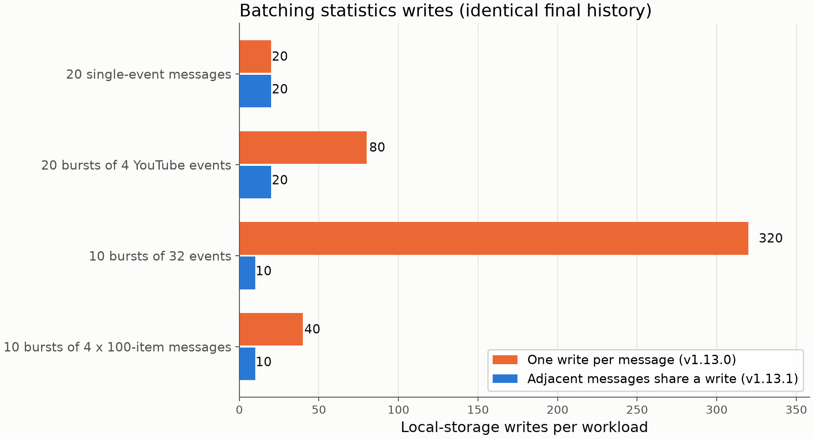

# Minimum Views Filter: hiding low-view posts on X and YouTube

X and YouTube try out new posts on a small audience first. If you are part of that audience, your feed fills with posts that have a few dozen views. The obvious response is to click "Not interested" on each one, but every click is more feedback for the recommender. You end up doing unpaid labelling work for the system you are trying to get away from.

[Minimum Views Filter](https://github.com/GerardWu100/minimum-views-filter) is a browser extension that takes the other route. It hides posts and videos below a view count you choose (1,000 by default) and never clicks anything on the site. On X it also looks at likes, bookmarks and replies per view. It works in Chrome, Brave (Chromium 109 or later) and Firefox (142 or later, as a Mozilla-signed add-on). The code is open source under the MIT License.

The chart at the top maps the default X rules over views and likes per view. The rest of this post explains its shape.

## What it filters, and where

Scope is narrow on purpose: X Home (For You and Following), YouTube Home, and the recommendations next to the video you are watching. Search, profiles, channels and every other page stay untouched.

The rules for one X post run in a fixed order:

1. A creator on your whitelist is always shown. You can add one by right-clicking a post and choosing "Always show this creator".
2. If the post has at least 100 views, and likes, bookmarks and replies per view all reach their keep thresholds (2%, 0.5% and 0.1%), it is shown even below the view minimum.
3. Otherwise, it is hidden if likes per view are below 0.5%, or if views are below the minimum.

A missing or ambiguous count is unknown, not zero, and unknown posts stay visible by default. YouTube uses only the view rules. Every rule has its own off switch.

Hiding is never permanent, because there is no blacklist of post IDs. A post hidden at 800 views that later shows 1,500 comes back, as long as the like rule also allows it. The local statistics history is never read to make a decision.

## Why ratios need a minimum sample

The keep rule asks every enabled ratio to pass at once (an earlier version accepted any one). With the defaults, 10 likes, 3 bookmarks and 1 reply on 500 views keeps a post, while 500 bookmarks with 9 likes does not. The harder design question is when to trust a ratio at all.

Let $v$ be a post's views and $c$ its likes, so the like rate is $r = c/v$. One extra like moves $r$ by $1/v$, which is 10 percentage points at 10 views and 1 point at 100 views. Two likes on ten views read as 20%, ten times the keep threshold, and mean almost nothing.

To size the noise, model each view as an independent trial that ends in a like with probability $p$. This is my simplification, not something the extension computes. Then $c$ is binomial and

$$
\operatorname{Var}(c) = v\,p\,(1-p), \qquad
\operatorname{Var}(r) = \operatorname{Var}\!\left(\frac{c}{v}\right) = \frac{\operatorname{Var}(c)}{v^2} = \frac{p\,(1-p)}{v},
$$

so the standard deviation of the measured rate is

$$
\sigma_r = \sqrt{\frac{p\,(1-p)}{v}}.
$$

At a true rate of $p = 2\%$, $\sigma_r$ is about 4.4 percentage points at 10 views, 1.4 at 100, 0.44 at 1,000 and 0.14 at 10,000. Noise shrinks only with $\sqrt{v}$: a hundred times more views buys ten times less noise.

The blue line is the jump from one extra like, $100/v$ percentage points. The orange line is the binomial standard deviation at a true 2% rate. Below about 50 views both are larger than the 2% keep threshold itself, so a high ratio there says more about luck than about the post. At 100 views the noise is still about 1.4 points, so one ratio alone remains weak evidence there.

So the extension sets a minimum sample. Below 100 views (adjustable), high ratios can neither keep nor highlight a post. The 100-view floor is a cheap cut-off, not a significance test, and the README says plainly that ratios still swing above it.

The asymmetry is the part I like. The minimum sample applies only to the rules that show posts. The low-like hiding rule works at every view count. A noisy ratio below 100 views can therefore only hide more, never show more, which fits the goal of not seeing tiny-sample posts on the strength of a lucky ratio.

Two smaller details sit in the comparison itself. The code never divides. It checks $100\,c \ge p\,v$, with $p$ in percent, plus a tiny machine-precision allowance, so a boundary case like 7 likes on 10,000 views (exactly 0.07%) still reaches a 0.07% threshold despite floating-point error. A post with zero views has no ratio and falls back to the view rule. Keep rules count a ratio equal to the threshold as a pass, while the highlight described below needs a ratio strictly above its threshold.

## Reading counts without asking the platform

The extension makes no platform requests and sends no analytics. Every number it uses is already in the page.

That is harder than it sounds. X shows "158K" on the button, but the accessibility label (the text a screen reader reads) often holds the exact count. The parser prefers exact labels over rounded text, and if two exact candidates disagree, the count is unknown. It ignores counts inside quoted posts and still reads labels when another extension hides the visible counter with CSS. It parses English and French formats ("1,2 M de vues" included); other languages stay visible.

One bug from the audit shows why this care matters. A YouTube title link's label also contains the channel name, and a channel named "10 views" was once read as the view count. The parser now strips the card's creator names from the label before it looks for a count.

This post shows the optional highlight, a 3-pixel amber edge with no background tint. By default it needs bookmarks per view above 1%, likes per view above 2% and replies per view above 0.1%. Here likes are 4.4K on 158K views (about 2.8%) and replies are 329 (about 0.21%). The bookmark button shows no number, but the accessibility label can hold an exact count, and it must be above about 1,580.

## Performance

A feed is a stream of small changes, so the extension routes each change to the card it belongs to instead of rescanning the page. In a synthetic 200-card feed, 20 single-card count changes needed 20 count reads instead of 4,000, and unrelated page changes needed none instead of 4,000. Hidden tabs pause observation. These figures count operations in a simulated page (jsdom); they are not browser CPU or memory measurements.

Statistics are kept separate from filtering. Adjacent history messages now share one local-storage read and write, up to 32 messages per transaction, with no timer that could delay hiding.

Each pair of bars is one benchmark workload, with the same final history in both versions. Single messages gain nothing. Bursts gain the most: 10 bursts of 32 events went from 320 writes to 10, and the median synthetic time from about 1,985 ms to 71 ms. Like the feed numbers, these come from mocked storage, not a real browser.

## What it cannot do

A local filter changes what you see, not what the platform logs. In a passive check of about four minutes on my X Home feed, 39 posts were hidden at some point. One of them still appeared in the `seenTweetIds` list that X sent with a later timeline request. That post was hidden 45 ms after it was first observed on the page. The version under test waited 80 ms before acting on changes. The extension now evaluates affected cards inside each change callback. That costs extra work when X fills a card in several steps (one staggered workload went from 20 to 80 count reads) and shortens the window without closing it. Startup, navigation and late-loading counts can still leave gaps, and the extension never intercepts or rewrites requests.

Counts can also be rounded or stale until you reload, and a site layout change can reduce coverage (cards then stay visible as unknown). Not clicking "Not interested" does not mean sending no signals: the platform still sees everything else you do.

Installation steps, every setting and the full benchmark notes are in the [GitHub repository](https://github.com/GerardWu100/minimum-views-filter).
