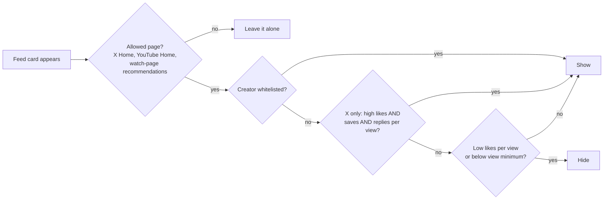

# Minimum Views Filter wiki

Minimum Views Filter is a browser extension for **Chrome, Brave and Firefox**. It
hides X posts and YouTube videos that have fewer views than a number you pick
(1,000 by default). It filters only in your browser. It never clicks "Not
interested", never likes, mutes or blocks, and never asks X or YouTube for data.

## Pages

| Page | What it answers |
|---|---|
| [[Install and Update]] | How to install and update in each browser |
| [[How Filtering Works]] | The rules, in order, with worked examples |
| [[X Threads and Thread Lines]] | Why a reply keeps its parent, and the vertical line between posts |
| [[Highlighting]] | The thin amber edge on high-engagement X posts |
| [[Statistics]] | What the Statistics page counts and keeps |
| [[Whitelists and Sync]] | Always show a creator; move settings between browsers |
| [[FAQ and Troubleshooting]] | Common questions and fixes |

The [README](https://github.com/GerardWu100/minimum-views-filter#readme) is the
full reference. The [releases page](https://github.com/GerardWu100/minimum-views-filter/releases)
has the downloads.
